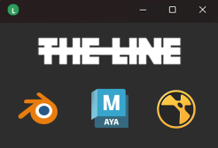

# CRITICAL BUG

Test an unpublished bundle source	

```Set TLS_PIPELINE_<HOST>_SOURCE=<source folder> and TLS_PIPELINE_SHARED_SOURCES=<folder of shared packages>, 
or launch --source <dir> --shared <dir> ..., or python structure/run_host.py <host> --source <dir>.
```

Running Nuke with the following Envs - 

```
"TLS_PIPELINE_NUKE_SOURCE": "D:/repos/tls-pipeline-localiser/structure/bundle_sources/nuke/2.0.0",
"TLS_PIPELINE_SHARED_SOURCES": "D:/repos/tls-pipeline-localiser/structure/shared_sources"
```

Results in 10 bundle directories inside `C:\Users\petea\AppData\Local\TheLine\dev\nuke`

each are the 18MB bundle size (total 180MB)

running again, creates another 10 folders. this shouldn't happen. 

I dont think we need hashed bundles copied locally. it's clearly the sync causing an issue as its got into a self perpetuating copy loop. I'd question if any dev build should be localised actually, it should be run from the source's location.


# UI 

I want to keep the settings, and the launcher seperate

Here's a mockup of a new dialog. the tray icon menu should have "launcher" menu option at the top. this should launch this design -



the latest hosts present should be shown only. 

The line logo has been added here -

`src\localiser\icons\TheLineLogo.svg`

super simple, and clicking the icon launches the DCC host.

The current settings menu item should load the pipeline manager UI

No settings adjustments should be possible from the launcher panel, it's just a host launch application. 

## Sync action

some kind of progress bar / spinner when a sync operation is occuring would be useful

## Need a UI to publish a bundle

Add a Release Tab to the settings UI

procedure -

- clone pipeline bundle feature

- choose host 
- set the version tag
- clone the bundle
- bundle is inside dev/hostname/tag/

Status tab - add an override button in the row for each dcc. launch can be replaced by a rocket icon

clicking overide exposes a drop down of all versions inside the dev folder (status column can show the drop down when this is enabled )

might be nice to show an orange background colour when a host is overidden in the ui.

# Global Pipeline Repository

Should have a method to be supplied by User or system ENV. This should take precedence when the application loads. 

If present, the tray application should have this field locked, with a mesaage saying it's controlled by the organisation. 

# Revisit the logging strategy

I dislike how the logs are written to file, and it's created a situation where 2 empyty CMD windows are spawned. I'd like to revert to leaving the logging to the hosts preference. Investigate why this was changed and try again

# Latest Issues

Release Workflow - Clone From discrepancies

you can point the bundle source folder to a zipped bundle location, there's no check for this.

should the tool detect no source code is correct and ask if the user wants to unzip the code?

question to be clarified - if you specified a published release, is this looking at the zipped bundles on the remote repository? or the localised code?

we should indicate in the list of published releases which is the current studio default.

If the application is changed, the release list should be refreshed. As I can invoke an error as I try to collect a release that's not present.

