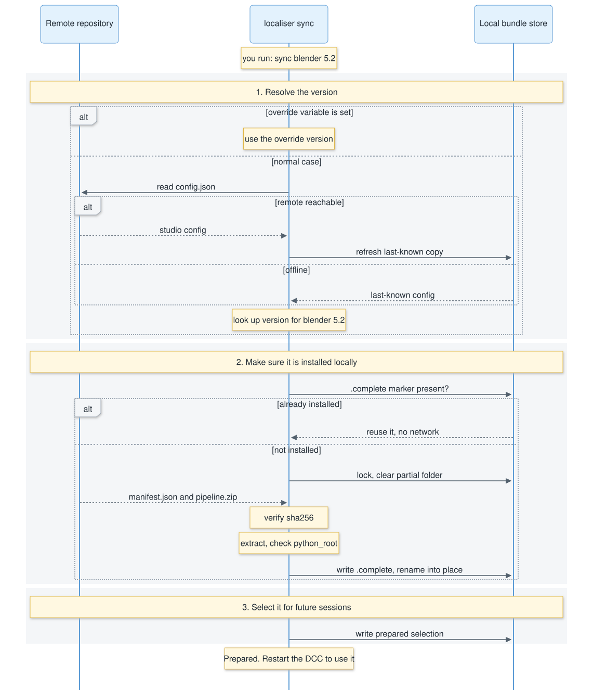

# Test workstation data flow

How the folders in [`structure/`](.) relate, which script writes each one, and how to make a new bundle. The diagrams are Mermaid sources in [`docs/diagrams/`](../docs/diagrams), rendered to SVG with `python docs/build_diagrams.py` (needs Node.js and Chrome or Edge). Edit the `.mmd` files, not the SVGs.

`bundle_sources` is **not** unpacked from `fake_remote_repository`. It is the other way round: `bundle_sources` holds the editable source, and the remote holds the published, zipped output built from it.

## Data flow

<!--  -->


## What each area is

<!--  -->


| Area | Role | Written by |
|---|---|---|
| `bundle_sources/` | Source folders, one per release. This is where bundles are authored. | You |
| `shared_sources/` | Packages every bundle needs, such as `tls_common` (logging). Copied into each bundle at publish time. | You |
| `THE-LINE/pipeline/fake_remote_repository/hosts/` | Stand-in for the network share: the zip and a manifest holding its sha256. | `build_test_workstation.py`, through `localiser publish` (wipes and republishes all of `hosts/` every run) |
| `THE-LINE/pipeline/fake_remote_repository/config.json` | The studio default: which bundle version each host and DCC series uses. | You, by hand |
| `THE-LINE/pipeline/localiser/` | A copy of `src/localiser`, as the installer would place it. | `build_test_workstation.py` |
| `THE-LINE/pipeline/bundles/` | Local store of extracted bundles, plus the per-host selection under `state/`. | `localiser sync` |
| `THE-LINE/pipeline/bootstrap/<host>/` | Stable stubs the DCCs find through their environment variables. | You, by hand |
| `THE-LINE/pipeline/config.json` | Local machine config pointing at the remote and the bundle store. | You, by hand |
| `THE-LINE/pipeline/__init__.py` | Shared entry the stubs call: loads the prepared bundle and runs its entry point. | You, by hand |
| `run_host.py` | Launches a DCC with the environment variables the studio would set. | You run it |

`fake_remote_repository/hosts/`, `localiser/` and `bundles/` are gitignored and can be regenerated.

## Making a new bundle

<!--  -->


Do not add to `fake_remote_repository`: it is generated, and the build script deletes anything placed there.

1. Create `structure/bundle_sources/<host>/<new version>/`. For Blender, copy the previous version as a starting point.
2. Run `python structure/build_test_workstation.py`. It publishes every version found in `bundle_sources`, including the new one, using the core's publisher. To publish just one bundle, anywhere, run `python -m localiser publish <source folder> <host> <version> --shared structure/shared_sources [--remote <repository>]`. Without `--remote` it publishes to `remote_repository` in the pipeline config.
3. In `fake_remote_repository/config.json`, set that host and series to `"bundle_version": "<new version>"`.
4. Sync, then restart the DCC:

   ```powershell
   $env:PYTHONPATH = "src"
   .\.venv\Scripts\python.exe -m localiser --pipeline structure\THE-LINE\pipeline sync blender 5.2
   ```

   Use `maya 2026` or `nuke 17.0` for the other hosts.

Without step 3, sync keeps resolving the old version: the new bundle is published but never selected.

Release IDs are immutable. If you change a version's contents after publishing it, rebuild and also delete its local copy first, otherwise sync keeps the old one:

- `THE-LINE/pipeline/bundles/hosts/<host>/<version>/`
- `THE-LINE/pipeline/bundles/state/manifests/<host>/<version>.json`

If you delete bundles from `bundles/` by hand, run sync again. The selection under `state/prepared/` remains, and DCC startup reports "prepared bundle is incomplete" until sync reinstalls it.

## What sync does

<!--  -->


Version resolution prefers the override variable, then the studio `config.json` on the remote, then the last-known-good copy kept locally for offline use. An already-installed release is reused without touching the network or hashing the zip.

## Where the remote repository lives

`remote_repository` in the local `config.json` is either a folder (a share) or an `https://` address. The layout is the same either way and is addressed by relative path, so one base holds everything:

```
<remote_repository>/config.json                          the studio config
<remote_repository>/hosts/<host>/<release>/manifest.json
<remote_repository>/hosts/<host>/<release>/pipeline.zip
```

`"remote_repository": "https://pipeline.example.com/line"` therefore needs only static file hosting (Firebase Hosting, a bucket behind a CDN, any web server). To move from a share to the web, publish to the folder behind the address with `localiser publish --remote <folder>` and change one line in the local config.

Web addresses are read-only, plain `http` is accepted only for loopback testing, and credentials, queries and fragments in the address are rejected. A redirect is followed only to an address that passes the same rules, so a downgrade to plain `http` is refused. Text files are limited to 1 MB and every request times out after 15 seconds. Integrity is unchanged: the zip's sha256 comes from the manifest. Unreachable web addresses behave exactly like an unreachable share: `check` reports offline, and `sync` reuses the last-known-good config and any installed release.

Firebase Realtime Database serves one JSON tree rather than files, so it can't be the whole repository, and its keys can't contain `.` (our `5.2` and `17.0` series). It would only fit if the studio config were separate from the artifacts, which is not built.

## Running something other than the selected release

`sync` selects one release per host and series for the whole machine. Three tools run something else without touching that selection:

| Need | How |
|---|---|
| Install a release now, for later use | `python -m localiser pull <host> <release>`. It installs but does not select, and it is the only step that needs the remote. |
| Run an installed release for one session, such as a project | Set `TLS_PIPELINE_<HOST>_BUNDLE=<release>`, or `launch --bundle <release> <host> <series> <exe>`. Startup never downloads, so the release must have been pulled; otherwise it fails and says which `pull` to run. |
| Test an unpublished bundle source | Set `TLS_PIPELINE_<HOST>_SOURCE=<source folder>` and `TLS_PIPELINE_SHARED_SOURCES=<folder of shared packages>`, or `launch --source <dir> --shared <dir> ...`, or `python structure/run_host.py <host> --source <dir>`. |

Dev mode runs the source **where it is**: nothing is copied. (It used to copy the source into `bundles/dev/<host>/<random>/` each time, and since a DCC can start several processes, one start left several 18 MB copies; the tray removes any such leftovers.) The entry point comes from the host defaults or `bundle.json`, and the shared packages are put on `sys.path` from their own folders (`TLS_PIPELINE_SHARED_SOURCES`) instead of being merged in, so each restart picks up your edits to the source and to the shared packages. A source that ships a package with a shared package's name is refused, as a publish would. There is no zip, no checksum and no remote. A folder made on the Create tab is already a complete bundle and runs the same way, with no shared folders needed.

A session starts with the first of these that applies: the source folder, then the pin, then the release `sync` selected. A source or pin that can't be used is an error, never a quiet fallback. The pipeline entry prints `RUNNING UNPUBLISHED SOURCE` or `PINNED ... bundle` so a session can't pass for a normal one. Both variables apply to every series of their host, and both only ever come from the environment, never from shared configuration. Treat a source folder like any code you run: the variable decides what executes in the DCC.

`sync` honours the same pin variable, and `sync --bundle <release>` is the shortcut: it selects that release machine-wide instead of the studio default, which stays sticky until the next plain `sync`. Options go before the host, because everything after the series belongs to the DCC command.

## Shared code

Bundles are per host, so code every host needs lives in `shared_sources/<package>/`, and the core's publisher (`localiser.plan_bundle` / `python -m localiser publish --shared <folder>`) merges each package into every bundle before zipping: to the bundle root, or to `modules/` for Blender. A release therefore stays one self-contained, checksummed zip that works offline, and rolling back a bundle rolls back its shared code too. A bundle can't ship a package with the same name as a shared one.

The entry point puts that folder on `sys.path` (Maya's and Nuke's bundle root, Blender's `<bundle>/modules`) and then `from tls_common import MayaLogger` (or `BlenderLogger`, `NukeLogger`).

### Logging: `tls_common`

All loggers live under one stdlib logger, `tls`, which owns the handler and format and does not propagate, so nothing prints twice through a host's or AYON's own handlers. Each tool subclasses its host class:

```python
from tls_common import MayaLogger

class PlayblastLogger(MayaLogger):
    NAME = "playblast"          # logs as tls.maya.playblast

PlayblastLogger.info("Output path %s", path)
```

A host class overrides `make_handler()` if stdout isn't the right place. `get_logger("name")` returns a plain stdlib logger under `tls` for code that prefers one.

| Variable | Effect |
|---|---|
| `TLS_LOG_LEVEL` | `DEBUG`, `INFO`, `WARNING`, `ERROR`, `CRITICAL` or a number. Default `INFO`. |
| `TLS_LOG_FILE` | A file that also receives `INFO` and above. |

## Installing for a user

An installation is per user and needs no elevation. The pipeline root is `%LOCALAPPDATA%\TheLine\pipeline` on Windows (`~/Library/Application Support/TheLine/Pipeline` on macOS, `$XDG_DATA_HOME/theline/pipeline` on Linux), and it holds `config.json`, `bootstrap/` and `localiser/`. When `TLS_PIPELINE` isn't set, the stubs and the CLI use that location, so no environment variable is needed. A first Windows installer run creates the config only if missing, with repository `P:\pipeline\repository` and bundle storage at `%LOCALAPPDATA%\TheLine\pipeline\bundles`, beside the code. If `TLS_PIPELINE` overrides the root, first-install bundle storage defaults to `<root>\bundles`. Existing configurations and bundle paths are retained across reinstalls; Windows also resolves the old uppercase `Pipeline` root without moving it. Config files without an explicit `bundle_repository` use `bundles/` relative to the config folder.

The local `config.json` adds optional keys to `remote_repository` and `bundle_repository`:

| Key | Meaning |
|---|---|
| `hosts` | The hosts and series the user supports, for example `{"maya": ["2026"], "nuke": ["17.0"]}`. Empty or absent follows the studio: a DCC loads the pipeline, and the tray app and `check-all`/`sync-all` keep up to date every version the studio config lists that is installed on this computer (so a fresh machine needs no setup). Once listed, a DCC version that isn't listed (Maya 2025, Blender 4.5) loads nothing and says so. An explicit pin or source always loads. |
| `check_interval_minutes` | How often the tray app checks (5 to 10080, default 240). |
| `auto_sync` | Whether the tray app applies updates itself (default true). |

The repository can also come from the environment: `TLS_PIPELINE_REPOSITORY` (a folder or an https address, set as a user or system variable by an organisation) takes precedence over `remote_repository` when the config is read. It is never written to `config.json`, `config.json` needs no `remote_repository` while it is set, and the tray app shows the field locked as controlled by the organisation.
Commands for the installer and the tray app:

| Command | What it does |
|---|---|
| `python -m localiser hosts` | The supported hosts, the versions installed here (from the standard install folders) and which are enabled. |
| `python -m localiser check-all` | Check every enabled host and series. Exit 0 current, 1 updates available, 2 a problem. Installs nothing. |
| `python -m localiser sync-all` | Sync every enabled host and series. One failing never stops the others; exit 2 if any failed. A series the studio config has no release for is reported as `unsupported`, not as a failure. |
| `python -m localiser install` | Put the stubs, the pipeline entry and the core into the pipeline root (see below). The tray app does this at every start. |
| `python -m localiser studio show` / `studio set <host> <series> <release\|none>` | List, or change, the studio config's entries in a repository folder. `none` writes `"bundle_version": null` (no pipeline loads for that version). |
| `python -m localiser provision [--remove]` | Optional. Install, or remove, a per-user entry each enabled DCC finds at startup (below). The tray app does not install these. |

`check-all` and `sync-all` record their result in `bundles/state/status.json`, which the tray app and the hosts read with no network access. `localiser.selection_changed(host, series, loaded_release_id, config)` lets a running DCC ask, from local state only, whether a newer release has been selected since it started.

### How each DCC finds the stub

The normal route is the launcher's environment: the tray app's Launch button (or AYON) starts the DCC with `TLS_PIPELINE` and the host's bootstrap folder in the variable it reads (see Environment variables below), and that stub loads `<root>/__init__.py`, which imports the core from `<root>/localiser`. `install` (run by the tray at every start) keeps `bootstrap/`, `__init__.py`, `about.py` and `localiser/` in the root equal to the ones that come with the app, replacing a file only when it differs and never touching `config.json`, bundles or state.

Optionally, `provision` makes a DCC started any other way load the pipeline too. Each DCC already reads a fixed per-user place at startup, so it puts a small entry there. All three point at `<root>/bootstrap/<host>`, so a stub update needs no change to them, and none touches a global environment variable such as `PYTHONPATH`. Nothing in the tray app writes them, so a normal launch of a DCC loads no pipeline unless you ran `provision`:

| Host | Entry | Verified |
|---|---|---|
| Maya | `<Documents>/maya/modules/TheLinePipeline.mod` (`+ TheLinePipeline 1.0 <stub folder>` and `PYTHONPATH +:= .`). Maya scans that folder by default. | Maya 2026, Windows |
| Nuke | a marked block in `~/.nuke/init.py` that calls `nuke.pluginAddPath` on the stub folder. The rest of the file is never touched, and `--remove` restores it. | Nuke 17.0v3, through a plugin-path folder |
| Blender | `<user scripts>/startup/tls_pipeline_startup.py`, a forwarder that loads the stub, under `%APPDATA%\Blender Foundation\Blender\<series>\scripts` | Blender 5.2, Windows |

Entries are idempotent. A file that isn't marked as ours is never overwritten or removed. `MAYA_APP_DIR` and `BLENDER_USER_SCRIPTS` are honoured where Maya and Blender honour them. The environment variables in the table below remain as overrides for a launcher such as AYON; the default entries don't need them.

### Updates reach users outside the DCC

A running DCC never polls for updates or interrupts the user. A session keeps the release it started with, and a newly selected release takes effect the next time the DCC starts. The tray app reports the result and applies updates (below). An in-DCC notice was tried (a timer in each host) and removed: on Maya 2026 it could not be shown to be safe during startup, and the stability risk outweighed the benefit.

### The tray app

`python -m localiser_tray` (`pip install .[tray]` for PySide6; add `--show` to open the manager at start). It lives in `src/localiser_tray/` and only calls the core. The tray icon is coloured by the worst state (grey nothing enabled, green current, amber updates waiting, red a problem), with a menu: **Launcher** (first; clicking the icon opens it too), the status line, Check for updates, Update now, **Settings...** (opens the pipeline manager) and Quit. Closing a window hides it; Quit exits.

To try it as an artist would, run `python -m localiser_tray --show` against your real profile: the pipeline root is `TLS_PIPELINE` if set, otherwise `%LOCALAPPDATA%\TheLine\pipeline`. At start it installs the stubs and core into that root. Without a local config, Settings opens: set the pipeline repository (the fake one for a test is `structure/THE-LINE/pipeline/fake_remote_repository`), tick the installed versions and Save, then Update now and Launch. The Windows installer seeds a first-run config with the defaults above, so installed users need not enter those locations. Only one tray runs at a time; quit an older one from its menu first.

- **Launcher.** A small window with the THE LINE logo and one icon per enabled application: the newest installed version of each. Clicking an icon starts it with the pipeline environment. Nothing in it can be changed. Clicking the tray icon opens the launcher; Shift-clicking the tray icon opens the Settings tab in normal mode, even if the manager was previously in admin mode. The app uses a fixed dark palette and Fusion widget style rather than the desktop's light/dark theme.
- **Progress.** While a check or update runs, the manager shows a bar and the application being worked on ("Updating Nuke 17.0 (2 of 3)"); the tray tooltip says the same.
- **When it checks.** At start, then whenever the last check recorded in `status.json` is older than `check_interval_minutes`; the app looks once a minute, which only reads that file. Checks run off the UI thread. With `auto_sync` on, anything newer is installed and selected in the same pass, and a tray notification says which application to restart. With it off, the update is reported once per set of updates and "Update now" applies it.
- **Status tab.** One row per enabled application and version: the release installed (what the next launch will load), the studio release and a sentence for the state, an **Override** button and a rocket button that starts that application from its standard install folder with the pipeline environment (for that process only), without waiting for it. A release that hasn't been prepared, or an application that isn't installed, is reported instead of started. The application's output is not captured: logging is the application's own (its console or script editor, and the files `tls_common` and the Nuke `PipelineLogger` write). It starts with a hidden console and its standard streams pointed at nothing (an app started from a shortcut has no console, and a host that inherits streams that don't exist fails to load the pipeline), and not with `DETACHED_PROCESS`, which makes every console program the application starts, such as Nuke's frame server, open its own empty window; Python in the host is told to write UTF-8 (`PYTHONIOENCODING`). A failed or unreachable repository keeps what is installed.
- **Override.** Switching Override on shows a drop-down of the bundles made on the Create tab (in `dev/<host>/`) in the Status column; the row turns orange and every launch of that application (tray or `launch`) runs the chosen bundle in place instead of the studio release, until Override is switched off. The choice is kept in `bundles/state/overrides.json`, survives restarts and is applied to the launched process only. A bundle that has been deleted stops the launch with a message rather than falling back.
- **Create tab.** Only shown in admin mode (see below). Opens with "What do you want to create?" and two big buttons; the choice decides which form is shown.
  - **A local pipeline bundle** (for developing new features). Choose the application, a version tag, and start from either a published release or a bundle source folder (with an optional shared-packages folder merged in, as a publish would). The release list shows what can be started from for the chosen application, newest first: the releases installed here, those published on the repository (listed only when it is a folder; an https repository can't be listed, so there it shows the installed ones and the ones the studio config names), with the studio default marked ("studio default (17.0)") and any not yet installed marked "downloaded when used". Starting from a release copies the extracted, local copy of it, installing it first from the repository's zip if need be. The list is rebuilt whenever the application changes, so it never offers another application's release. If the source folder holds a zipped bundle (a `.zip`, or a published release folder with `pipeline.zip`) the app says so and asks whether to unzip it and start from what is inside; an empty folder is refused with a reason. The result is `bundles/dev/<host>/<tag>/`, laid out as a release extracts, with a `.tls-clone.json` marker. An existing tag is never overwritten. Override an application with it on the Status tab.
  - **Publish new studio bundle** (push a new release to the studio repository). Choose the application, the release version, and publish from either a local development bundle (the version defaults to its folder name and can be changed) or a bundle source folder that lives somewhere else. A development bundle is published as it is, minus its marker; a source folder is published as `python -m localiser publish` would, with any shared-packages folder you give merged in. Shared packages (such as logging) rarely change, so they are normally already inside the bundle, and the folder is usually left empty. The app asks before publishing, because a release can't be changed or removed afterwards, and it needs the repository to be a folder (an https repository can't be published to). Publishing does not select the release: nothing uses it until `bundle_version` in the studio config names it. A zipped source is refused.
- **Admin mode.** Hold Shift while choosing **Settings...** in the tray menu (or start the app with `--admin`). The manager title becomes "THE LINE Pipeline - ADMIN MODE", the Status tab shows an admin badge, the **Create** tab appears (it is hidden otherwise), and the **Studio release** column becomes a drop-down per row: `(none)` plus every release published in the repository. Rows are this computer's enabled versions plus any version the studio config lists that isn't enabled here ("Not enabled on this computer", editable but not synced). Choosing a release writes that one entry of the studio config (`localiser.set_studio_bundle`, the same as `python -m localiser studio set <host> <series> <release|none>`), then runs an update so the change is applied here straight away; everyone else gets it at their next check. Admin mode lasts until Settings... is opened again without Shift, the tray icon is Shift-clicked, or the window is closed. It needs a repository that is a folder you can write to; otherwise the drop-downs are disabled and say why. It is not a security boundary: no password, and the folder's permissions are what protect the studio config.
- **No bundle.** `(none)` writes `"bundle_version": null` for that version. The version stays listed, shows "No studio bundle selected - the pipeline won't load", and an update clears the version's selection, so a DCC started afterwards prints a warning (`TLS pipeline: WARNING the studio has no bundle selected for ...`) and loads no pipeline. Installed bundles are left on disk, and a pin or a dev source still loads. Older copies of the tool reject a studio config containing `null`, so update the tool on every machine before using it.
- **Settings tab.** In normal and admin mode, tick the installed versions of each application under "Applications to keep up to date" (found in the standard install folders; versions enabled but not found are kept and marked). The other settings are the pipeline repository (a shared folder or an https address; locked and explained when `TLS_PIPELINE_REPOSITORY` supplies it), the local releases folder, the interval and `auto_sync`. A selectable application version at the bottom identifies the running installer release (not a host bundle version), from package metadata shipped with the app. Save is one validated write to `config.json` (`localiser.apply_hosts`): nothing changes if any value is rejected. It then runs an update. It writes no per-application entries and never touches the studio config. On a first run with no `config.json`, the app opens on Settings and Save creates it (with `TLS_PIPELINE_REPOSITORY` set the config is created for you).
- **One copy.** A lock file in the temp folder stops a second tray icon from a second launch.
- **Pipeline code.** At every start the app runs `install_pipeline_code`, so the root holds the stubs, entry and core that came with the app. It reads them from `structure/THE-LINE/pipeline` and this package in a checkout; shipping them inside an installed package is not done yet, and the app says so in Settings if they can't be found.
- **Not in the app yet.** Starting at login, and cleaning up old releases.

## Bundle layout

### Adding an application

The supported applications are defined in code, not config: `HOSTS` in [`src/localiser/hosts.py`](../src/localiser/hosts.py), one `HostInfo` each: the id used everywhere (config, folders, variables), the display name, `discovery_variable` (the variable a launcher sets so the DCC finds its stub: `PYTHONPATH`, `NUKE_PATH`, `BLENDER_SYSTEM_SCRIPTS`), `python_root` and `shared_destination` (the bundle layout), `install_folder` and `install_pattern` (how installed versions are found under Program Files) and `executable`. Around it:

| What | Where |
|---|---|
| Icon, shown in every window | `src/localiser/icons/<id>.png` |
| The stub the DCC runs | `structure/THE-LINE/pipeline/bootstrap/<id>/` |
| Which bundle each version gets | the studio config's `hosts.<id>` (edited in admin mode) |
| Which versions a user runs | the local config's `hosts` (the "Applications to keep up to date" tickboxes) |

Config only chooses among what `HOSTS` defines, so a new application needs a `HOSTS` entry, an icon and a stub (and a bundle source). Harmony has a stub and a bundle source but no `HOSTS` entry yet, so it isn't offered. Making the list configurable is possible later but isn't done.

The bundle's entry point is `<python_root>/__init__.py`. The publisher uses `python_root` `startup` and shared destination `modules` for Blender, and `.` for both for other hosts. A `bundle.json` at the root of a source folder overrides them (`{"schema_version": 1, "python_root": "...", "shared_destination": "..."}`); it is publishing metadata and isn't shipped in the zip.

A Blender bundle may contain, all optional apart from `startup/`:

| Folder | What the Blender stub does with it |
|---|---|
| `startup/` | The bundle entry point, run during startup. |
| `splash/splash.png` | Sets `BLENDER_CUSTOM_SPLASH` to this file. |
| `extensions/<id>/` | Local extension repository `tls_pipeline`. Each folder needs a `blender_manifest.toml` and must be named after its `id`. |
| `addons/<name>/` | Legacy add-ons (`bl_info`). Keep extensions out of this folder, or Blender lists them twice. |
| `assets/TLP_<name>/` | Each immediate `TLP_` folder becomes an asset library named after the folder, using Link imports and absolute paths (relative paths disabled). |
| `modules/`, `presets/` | Available through the `THELINE_PIPELINE` script directory, which points at the bundle root. |

Everything in `extensions/` and `addons/` is enabled and recorded in the user's preferences. Each launch rewrites the script-directory and repository paths and drops `tls_pipeline` extensions the release no longer ships.

`TLP_` is reserved for pipeline-owned asset library names. Each launch updates matching libraries to the active bundle, enforces Link imports and disables relative paths, and removes stale or duplicate `TLP_` entries, even if the bundle has no `assets/` directory. Other libraries and asset files are never removed or changed, and startup does not explicitly save user preferences. Non-prefixed folders and loose files directly under `assets/` are ignored. The `.blend` files must contain assets marked in Blender; categories within a library are Blender catalogs (`blender_assets.cats.txt`), not simply subfolders.

A Maya bundle's root `__init__.py` is its entry point (`python_root` is `.`), and it does two things at startup:

- **Paths:** it appends the bundle root and each top-level directory to `sys.path`, last so nothing already on the path is shadowed. `import playblast_plus` and `import LineTools` work, and so does `from anim.PublishPlusCreator import ui`.
- **Menu:** `LineTools/menu.py` builds a **THE LINE** menu by scanning the folders in `LineTools/` on every Maya start, so a new script or folder appears with no menu definition to maintain. Scripts in `_`-prefixed folders (`_global`, `_scene`) are listed at the top level, every other folder becomes a submenu, and empty folders are skipped. Each script runs as `__main__`, so keep its code under `if __name__ == "__main__":`. There is no menu in batch or `mayapy` sessions.
- **Missing tools:** a script that needs a module the bundle doesn't ship (one AYON provides, say) declares it at the top, for example `REQUIRES = {"dwpicker": "comes from the AYON tool descriptor"}`, or a plain list of names. The runner checks before running, logs one warning line without a traceback, and shows the same text as a viewport message. The menu tooltip lists what the script needs. An undeclared missing import gets the same treatment.

A Nuke bundle's root `__init__.py` adds `core/` with `nuke.pluginAddPath`, so Nuke runs `core/init.py` once the stub returns and `core/menu.py` when the UI loads. Everything is derived from where `core/` sits, so nothing depends on `NUKE_PATH`, which stays the studio's. `core/init.py` exports `TLA_COMP_CORE` (the core folder), `TLA_COMP_PIPELINE_ROOT` and `TLA_COMP_TOOLCHAINS`, and `toolchains/<name>/` holds one copy of each tool with no version folders. The release id is the version shown in the banner. Runtime logs go to `bundles/logs` (set as `TLS_LOG_DIR` by the entry), never into a release. `core/utils/PipelineLogger.py` keeps its API but sits on `tls_common`: every pipeline logger is `tls.nuke.<name>`, the console and daily `pipeline_<date>.log` handlers live on the `tls` logger, and Nuke's and AYON's root logger is left alone.

## Environment variables

The environment is only ever supplied to the process that starts a host; nothing is written to the user's persistent environment (the registry), because a persistent value is global, outlives the tool that set it and is hard to administer. A host gets its environment from one of:

- **AYON**, as part of its own launch of a host (the same variables below).
- **The tray app's launcher and rocket buttons** (the Launcher window, and the Status tab, one per enabled application and version), which start the installed program with the variables below for that process only (`localiser.launch.launch_host`). The `launch` command and `run_host.py` do the same from a terminal.

Maya, Nuke and Blender can also find the stub without any variable through the per-user entries `provision` installs (above, optional); the tray app doesn't install them.

Every host also has an **About** item that shows the release, where it came from (studio default, pinned or unpublished source) and the bundle path: Nuke under Help (`bootstrap/nuke/menu.py`), Blender under Help (the stub; only when a bundle is loaded) and Maya as the last item of the THE LINE menu (`LineTools/menu.py`, so it ships with the Maya bundle). The text comes from `pipeline/about.py`, which reads the variables below, so a host needs no other access to the pipeline.

| Variable | Set by | Value |
|---|---|---|
| `TLS_PIPELINE` | AYON / the tray's Launch / `run_host.py` | the pipeline root (`structure/THE-LINE/pipeline`) |
| `PYTHONPATH` (Maya), `NUKE_PATH`, `BLENDER_SYSTEM_SCRIPTS` | AYON / the tray's Launch / `run_host.py` | `<root>/bootstrap/<host>` |
| `TLS_PIPELINE_MAYA` / `_NUKE` / `_BLENDER` | the localiser | the resolved bundle path |
| `TLS_PIPELINE_<HOST>_RELEASE`, `TLS_PIPELINE_<HOST>_MODE` | the localiser | what this session is running: the release id (`1.1.0`, or `dev-<name>`) and `studio` (following the studio config), `pinned` or `dev`. Identity only: set at startup for anything in the DCC to read (a Nuke label `[getenv TLS_PIPELINE_NUKE_RELEASE]`, MEL `getenv`), never read back by the core. Different from the `_BUNDLE` and `_SOURCE` inputs below. |
| `TLS_PIPELINE_<HOST>_BUNDLE` | you / AYON hook | pin this session to an installed release (also what `sync` selects) |
| `TLS_PIPELINE_<HOST>_SOURCE` | you / the tray's Override | run a bundle source folder or a clone in place (dev mode) |
| `TLS_PIPELINE_SHARED_SOURCES` | you | folders of shared packages put on `sys.path` for a dev source (`;`-separated on Windows) |
| `TLS_PIPELINE_REPOSITORY` | your organisation / you | the pipeline repository (a folder or https address); overrides `remote_repository` and locks it in the tray app |
| `BLENDER_CUSTOM_SPLASH` | the Blender stub | the bundle's `splash/splash.png`, when present |

### AYON launch examples

These are Windows application-environment entries for AYON Applications. `{LOCALAPPDATA}` is expanded from AYON's inherited environment. The stubs read `config.json` in `TLS_PIPELINE`, so AYON does not need to specify the bundle download directory. Install the app and start the tray once to deploy the pipeline code; sync/download the required bundles before launching a DCC. Startup is local-only and never downloads a missing release.

Installer 0.1.6 defaults new installations to `{LOCALAPPDATA}\TheLine\pipeline\bundles`, beside the pipeline code. Existing configurations retain their saved bundle location; upgrading does not move downloaded releases.

The examples below pin each host to its already installed `1.0.0` release. Replace that ID with the actual installed release for each host. To follow the release last selected by sync instead, omit the corresponding `TLS_PIPELINE_<HOST>_BUNDLE` entry.

**Nuke**

```json
{
    "TLS_PIPELINE": "{LOCALAPPDATA}\\TheLine\\pipeline",
    "NUKE_PATH": "{LOCALAPPDATA}\\TheLine\\pipeline\\bootstrap\\nuke",
    "TLS_PIPELINE_NUKE_BUNDLE": "1.0.0"
}
```

**Maya**

```json
{
    "TLS_PIPELINE": "{LOCALAPPDATA}\\TheLine\\pipeline",
    "PYTHONPATH": "{LOCALAPPDATA}\\TheLine\\pipeline\\bootstrap\\maya",
    "TLS_PIPELINE_MAYA_BUNDLE": "1.0.0"
}
```

**Blender**

```json
{
    "TLS_PIPELINE": "{LOCALAPPDATA}\\TheLine\\pipeline",
    "BLENDER_SYSTEM_SCRIPTS": "{LOCALAPPDATA}\\TheLine\\pipeline\\bootstrap\\blender",
    "TLS_PIPELINE_BLENDER_BUNDLE": "1.0.0"
}
```

Preserve any existing `NUKE_PATH` or `PYTHONPATH` entries by adding the stub path to the list rather than replacing it. AYON accepts path lists; if the corresponding variable is already defined in the inherited environment, it can be included as `"{NUKE_PATH}"` or `"{PYTHONPATH}"`. Do not include an undefined self-reference: AYON leaves missing tokens literal. Blender accepts a single `BLENDER_SYSTEM_SCRIPTS` directory, not a path list.

`TLS_PIPELINE_<HOST>_BUNDLE` takes a release ID, not a folder path. Remove the corresponding `TLS_PIPELINE_<HOST>_SOURCE` variable when using a pin: source mode takes precedence. Do not point `_SOURCE` at a downloaded release under `bundles\hosts\<host>\<release>`; use `_BUNDLE` and let the local config locate the installed release.

`TLS_PIPELINE_<HOST>_SOURCE` is only for an unpublished source folder or local development clone. A correctly published bundle is self-contained and needs no `TLS_PIPELINE_SHARED_SOURCES`. An ordinary raw source that keeps shared packages elsewhere can set `TLS_PIPELINE_SHARED_SOURCES` to the parent folder containing those packages (for example `D:\repos\tls-pipeline-localiser\structure\shared_sources`), not to `tls_common` itself. Clones are already complete bundles and do not use that variable; missing dependencies in a clone must be included in the clone.
